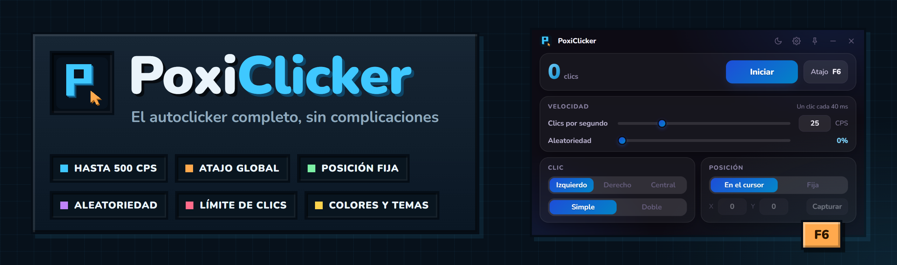
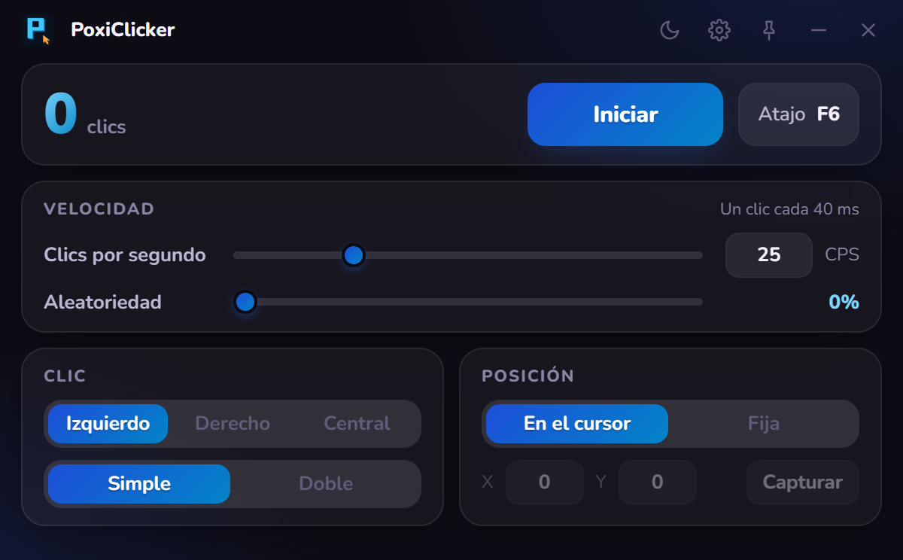
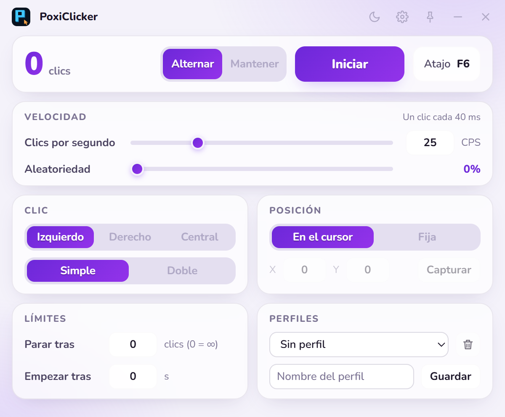

<div align="center">



<br />


**🇪🇸 Español** · [🇬🇧 English](#-english)

### El autoclicker **completo y sin complicaciones**.

Todo en una sola ventana, sin scroll. Eliges la velocidad, el botón y dónde clicar,
y lo enciendes y apagas con **un atajo global** desde cualquier programa.
Modo **Simple** para lo básico y modo **Avanzado** para los que quieren más.

</div>

---

## 🎯 Qué es

**PoxiClicker** es un autoclicker para Windows, ligero y con un diseño cuidado. Hace clics reales de ratón
(no simulados dentro de la app), con un temporizador de alta precisión para que **100 CPS o más** salgan estables
y no a trompicones.

## 📸 Así se ve

<table>
  <tr>
    <td width="50%"></td>
    <td width="50%"></td>
  </tr>
  <tr>
    <td align="center"><sub>🟦 Modo <b>Simple</b>: lo básico, en una ventana pequeña</sub></td>
    <td align="center"><sub>☀️ Modo <b>Avanzado</b> con tema claro y acento violeta</sub></td>
  </tr>
</table>

## 📥 Descarga

| Archivo | Para qué |
|---|---|
| **[`PoxiClicker-Setup-1.0.0.exe`](https://github.com/PoxiiTV/PoxiClicker/releases/download/v1.0.0/PoxiClicker-Setup-1.0.0.exe)** | **Instalador** de un clic (sin «siguiente, siguiente»): crea los accesos y **se actualiza solo** |
| [`PoxiClicker-Portable-1.0.0.exe`](https://github.com/PoxiiTV/PoxiClicker/releases/download/v1.0.0/PoxiClicker-Portable-1.0.0.exe) | **Portable**: se abre tal cual, sin instalar nada |

Todas las versiones y sus novedades, en [**Releases**](https://github.com/PoxiiTV/PoxiClicker/releases).

> ℹ️ Como el `.exe` aún no está firmado, Windows puede enseñar el aviso azul de SmartScreen:
> **Más información → Ejecutar de todas formas.** No pide administrador **nunca**.
>
> ⚖️ Pesan unos 110 MB porque llevan dentro el motor de Electron; el código de PoxiClicker en sí ocupa 1,5 MB.

## 🌟 Qué puede hacer

| | |
|---|---|
| ⚡ **Velocidad** | De **0,1 a 500 clics por segundo**, con barra y casilla. Te dice cada cuántos milisegundos clica |
| 🎲 **Aleatoriedad** | Varía el tiempo entre clics hasta un **50 %** para que no sea una cadencia perfecta |
| 🖱️ **Botón y tipo** | Izquierdo, derecho o central; clic **simple o doble** |
| 📍 **Posición** | Clica **donde esté el cursor** o en una **posición fija** (pulsa *Capturar*, coloca el ratón y listo) |
| 🛑 **Límites** | **Para tras N clics** y/o **empieza tras N segundos** |
| ⌨️ **Atajo global** | **F6** por defecto, cambiable con cualquier tecla (con o sin Ctrl/Alt/Shift). Funciona con la ventana en segundo plano |
| 🎨 **Aspecto** | **6 colores** de acento, tema **claro u oscuro** y botón de **siempre visible**, desde el icono de **ajustes** ⚙️ |
| 🧩 **Simple / Avanzado** | **Simple** enseña lo básico en una ventana pequeña. **Avanzado** añade límites, modo *Mantener* y perfiles |
| ✊ **Modo Mantener** *(avanzado)* | Clica **solo mientras mantienes pulsado** el atajo, además del modo *Alternar* (pulsar para empezar, pulsar para parar) |
| 📁 **Perfiles** *(avanzado)* | Guarda tus ajustes con nombre («Cookie Clicker», «Farmeo»…) y cámbialos con un clic |
| 🔄 **Se actualiza solo** | Al abrirse avisa si hay versión nueva: pulsas **Actualizar**, baja con barra de progreso, se instala **en silencio** y se **reabre sola** |
| 💾 | Guarda tu configuración entre sesiones |

## 🚀 Cómo se usa

1. Ajusta la velocidad, el botón y la posición.
2. Pulsa **Iniciar** o tu atajo (**F6**) desde donde quieras.
3. Vuelve a pulsarlo para parar (o deja que pare solo al llegar al límite).

> 💡 En **Ajustes ⚙️** cambias entre **Simple** y **Avanzado**, el tema y el color.
> En modo *Mantener* el atajo debe ser una letra, un número, F1–F24 o Espacio.

## ⚠️ Avisos

- Algunos **juegos con anticheat** pueden ignorar o bloquear clics generados por software. Úsalo bajo tu responsabilidad.
- No pide **administrador** nunca. El ayudante de clics es un script de PowerShell incluido en la app.
- La **versión portable** no puede reemplazarse a sí misma: avisa de la versión nueva y abre la página de descarga.

## 🔧 Compilar

Necesitas [Node.js](https://nodejs.org) 20 o superior.

```bash
npm install
npm start          # modo desarrollo (o start.bat)
npm run dist       # instalador + portable en release/ (o build.bat)
```

## 📜 Licencia

[PolyForm Noncommercial 1.0.0](LICENSE) · © 2026 Poxi

---
<br />

<a id="-english"></a>

<div align="center">

**[🇪🇸 Español](#)** · **🇬🇧 English**

### The **complete, no-fuss** autoclicker.

Everything in a single window, no scrolling. Pick the speed, the button and where to click,
and toggle it with a **global hotkey** from any program.
**Simple** mode for the basics and **Advanced** mode for those who want more.

</div>

## 🎯 What it is

**PoxiClicker** is a lightweight, carefully designed autoclicker for Windows. It sends real mouse clicks
(not simulated inside the app) with a high-precision timer, so **100 CPS and up** stays steady instead of stuttering.

## 📥 Download

| File | What for |
|---|---|
| **[`PoxiClicker-Setup-1.0.0.exe`](https://github.com/PoxiiTV/PoxiClicker/releases/download/v1.0.0/PoxiClicker-Setup-1.0.0.exe)** | One-click **installer** (no «next, next»): creates shortcuts and **updates itself** |
| [`PoxiClicker-Portable-1.0.0.exe`](https://github.com/PoxiiTV/PoxiClicker/releases/download/v1.0.0/PoxiClicker-Portable-1.0.0.exe) | **Portable**: runs as is, nothing to install |

All versions and release notes live in [**Releases**](https://github.com/PoxiiTV/PoxiClicker/releases).

> ℹ️ The `.exe` is not code-signed yet, so Windows may show the blue SmartScreen warning:
> **More info → Run anyway.** It **never** asks for administrator rights.

## 🌟 What it can do

| | |
|---|---|
| ⚡ **Speed** | From **0.1 to 500 clicks per second**, with a slider and a number box. Shows the interval in milliseconds |
| 🎲 **Randomness** | Varies the time between clicks by up to **50 %** so the rhythm isn't perfectly regular |
| 🖱️ **Button and type** | Left, right or middle; **single or double** click |
| 📍 **Position** | Click **wherever the cursor is** or at a **fixed position** (hit *Capture*, place the mouse, done) |
| 🛑 **Limits** | **Stop after N clicks** and/or **start after N seconds** |
| ⌨️ **Global hotkey** | **F6** by default, rebindable to any key (with or without Ctrl/Alt/Shift). Works while the window is in the background |
| 🎨 **Look** | **6 accent colors**, **light or dark** theme and an **always on top** toggle, from the **settings** ⚙️ icon |
| 🧩 **Simple / Advanced** | **Simple** shows the basics in a small window. **Advanced** adds limits, *Hold* mode and profiles |
| ✊ **Hold mode** *(advanced)* | Clicks **only while you hold** the hotkey, besides *Toggle* mode (press to start, press to stop) |
| 📁 **Profiles** *(advanced)* | Save your settings by name and switch with one click |
| 🔄 **Self-updating** | On launch it tells you about a new version: press **Update**, it downloads with a progress bar, installs **silently** and **reopens itself** |
| 💾 | Remembers your settings between sessions |

## ⚠️ Notices

- Some **games with anti-cheat** may ignore or block software-generated clicks. Use at your own risk.
- It **never** asks for administrator rights. The click helper is a PowerShell script bundled with the app.
- The **portable version** cannot replace itself: it tells you about the new version and opens the download page.

## 🔧 Building

You need [Node.js](https://nodejs.org) 20 or newer.

```bash
npm install
npm start          # development (or start.bat)
npm run dist       # installer + portable in release/ (or build.bat)
```

## 📜 License

[PolyForm Noncommercial 1.0.0](LICENSE) · © 2026 Poxi
